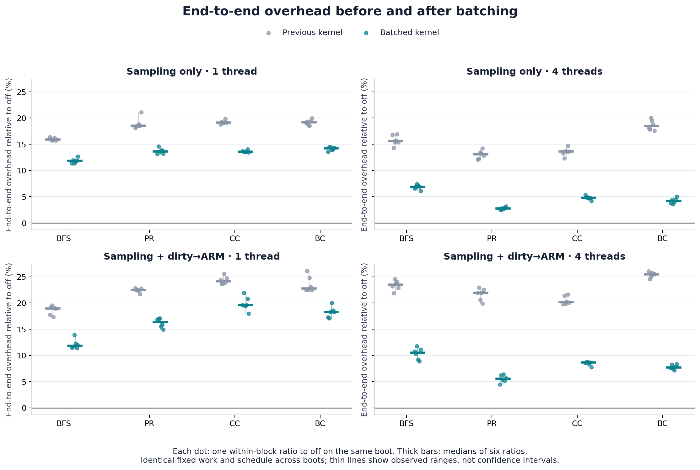
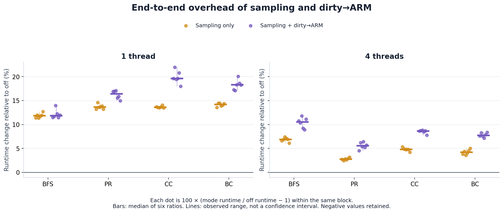
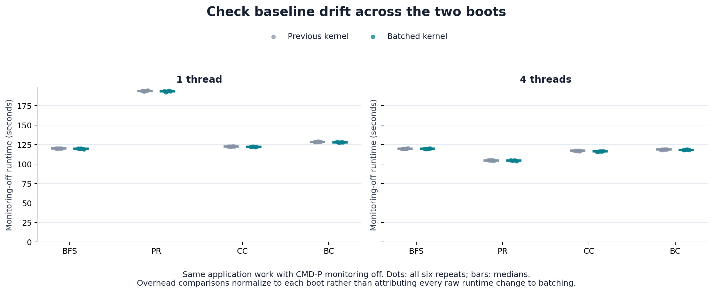
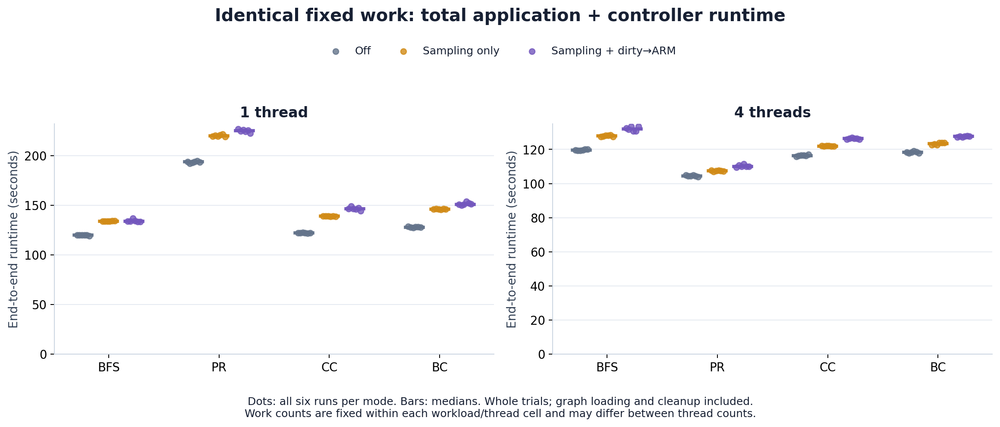
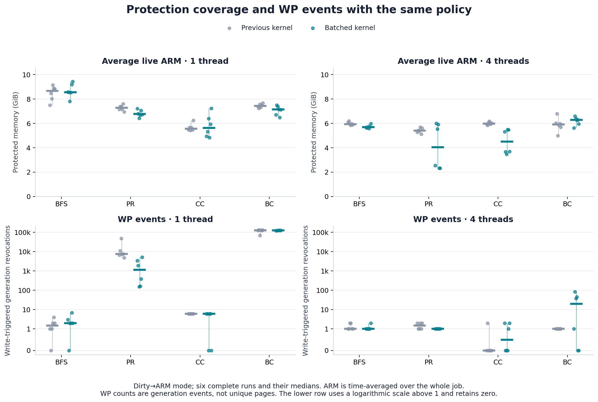
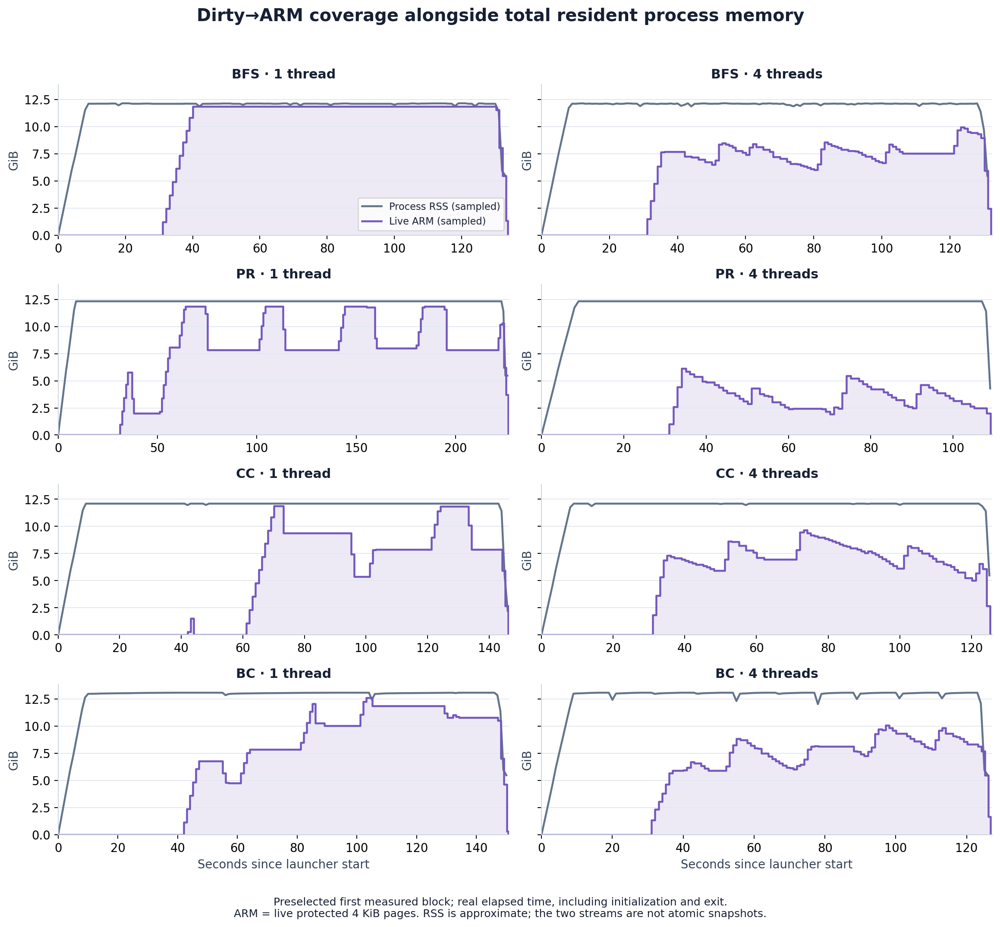
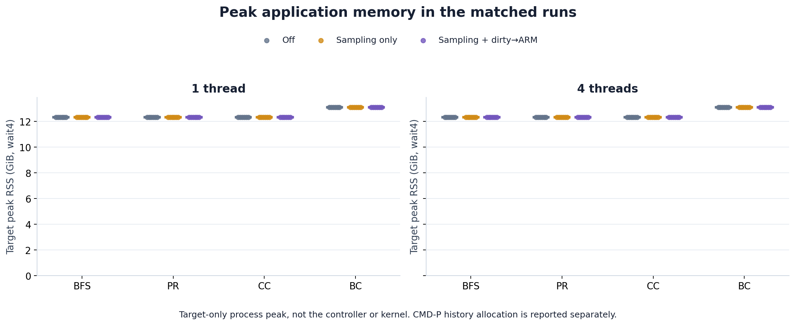
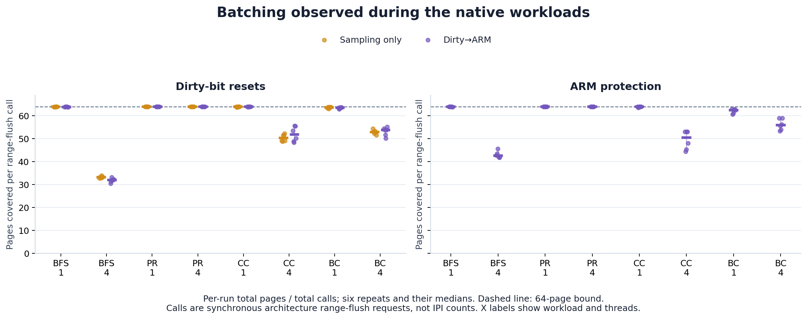

# Batched GAPBS overhead — 2026-10-22

**144/144 measured runs passed:** BFS, PR, CC and BC; one/four threads; off (A), dirty sampling only (B), and sampling + dirty→ARM (C); six matched blocks. No measured failures, retries or exclusions.

Median sampling overhead changed from **13.1–19.2%** to **2.7–14.2%** across the eight cells. Full dirty→ARM overhead changed from **19.0–25.5%** to **5.5–19.6%**. Full-mode median overhead was lower in 8/8 cells. These are ranges of cell medians, not pooled estimates or confidence intervals.

Measured campaign: 2026-10-22 15:38:55 CDT through 2026-10-22 21:17:30 CDT. Kernel: `7.2.6-cmdp-batch-production`. The earlier campaign used `7.2.6-cmdp-rearm-production`.

## Before and after batching

Each percentage is the median of six within-block runtime ratios to monitoring off on the same boot. Both campaigns use byte-identical frozen work/schedule, the same graph, GAPBS binaries, controller binary, timing executor and recorded controls. All three requested optimizations are enabled together; this comparison does not separate their individual contributions.

| Workload · threads | Sampling, previous | Sampling, batched | Dirty→ARM, previous | Dirty→ARM, batched | Full-mode change (percentage points) |
| --- | ---: | ---: | ---: | ---: | ---: |
| BFS · 1 | 15.9% | 11.8% | 19.0% | 11.8% | -7.1 |
| BFS · 4 | 15.6% | 6.9% | 23.5% | 10.5% | -13.0 |
| PR · 1 | 18.5% | 13.6% | 22.5% | 16.4% | -6.1 |
| PR · 4 | 13.1% | 2.7% | 21.9% | 5.5% | -16.4 |
| CC · 1 | 19.1% | 13.6% | 24.1% | 19.6% | -4.6 |
| CC · 4 | 13.6% | 4.8% | 20.2% | 8.6% | -11.5 |
| BC · 1 | 19.2% | 14.2% | 22.8% | 18.3% | -4.5 |
| BC · 4 | 18.5% | 4.2% | 25.5% | 7.7% | -17.8 |



## Repeated-run variation

Median [minimum–maximum] of six paired percentages, `100 × (numerator / denominator − 1)`. Thin plot ranges describe observed variation, not confidence intervals. Every A/B/C permutation occurs once per cell. All successful observations are retained, including slower cases.

| Workload · threads | Sampling / off | Dirty→ARM / off | Dirty→ARM / sampling |
| --- | ---: | ---: | ---: |
| BFS · 1 | 11.8% [11.4–12.7] | 11.8% [11.4–13.9] | -0.1% [-0.6–2.3] |
| BFS · 4 | 6.9% [6.1–7.4] | 10.5% [8.9–11.8] | 3.6% [1.8–4.7] |
| PR · 1 | 13.6% [13.2–14.6] | 16.4% [15.0–17.1] | 1.9% [1.6–3.3] |
| PR · 4 | 2.7% [2.4–3.1] | 5.5% [4.5–6.4] | 2.5% [1.7–3.7] |
| CC · 1 | 13.6% [13.4–14.0] | 19.6% [18.0–22.0] | 5.2% [4.0–7.4] |
| CC · 4 | 4.8% [4.2–5.3] | 8.6% [7.8–8.8] | 3.6% [3.1–3.8] |
| BC · 1 | 14.2% [13.5–14.5] | 18.3% [17.1–20.0] | 3.4% [2.3–5.4] |
| BC · 4 | 4.2% [3.6–5.0] | 7.7% [7.1–8.3] | 3.4% [3.0–3.8] |

C/B compares two active policies. C can skip pages already under ARM and changes scan/admission/recovery activity. A negative C/B result is retained; it does not imply a negative fault-handler cost. Percentage changes are not additive.



## Fixed work, runtime and baseline drift

Off-mode median runtime drift across boots ranges from -0.67% to -0.02%. The before/after overhead comparison normalizes each mode to its own matched off run. Across-boot differences remain observational even with unchanged recorded controls.

| Workload · threads | Trials | Off A (s) | Sampling B (s) | Dirty→ARM C (s) | Off drift vs previous |
| --- | ---: | ---: | ---: | ---: | ---: |
| BFS · 1 | 38 | 119.90 | 134.04 | 133.94 | -0.16% |
| BFS · 4 | 127 | 119.61 | 127.88 | 132.10 | -0.02% |
| PR · 1 | 1 | 193.83 | 220.01 | 225.24 | -0.22% |
| PR · 4 | 2 | 104.51 | 107.48 | 110.04 | -0.18% |
| CC · 1 | 24 | 122.33 | 139.02 | 146.41 | -0.29% |
| CC · 4 | 86 | 116.37 | 121.96 | 126.31 | -0.67% |
| BC · 1 | 3 | 128.03 | 146.15 | 151.07 | -0.43% |
| BC · 4 | 10 | 118.30 | 123.46 | 127.64 | -0.49% |

Primary time spans common-launcher invocation through blocking wait completion, including graph loading/initialization, all algorithm trials, target exit and controller STOP/drain. Cache warming is outside timing. PR uses 21 fixed iterations (`-t 0`); BC uses one source per trial. PR-1 retains one complete trial even though it exceeds two minutes. Work counts differ across thread counts, so these runtimes do not measure thread speedup.





## Coverage, WP events and memory

Mean live ARM integrates protected byte-time over the entire job. WP counts are CMD-P generations terminated by a write, not unique pages or every Linux fault. The same ten-second policy can produce different sweep counts and phase alignment when runtime changes; coverage and WP changes therefore need to be read alongside runtime.

| Workload · threads | Mean ARM previous (GiB) | Mean ARM batched (GiB) | WP previous, range | WP batched, range | Batched C sweeps, range |
| --- | ---: | ---: | ---: | ---: | ---: |
| BFS · 1 | 8.66 | 8.56 | 0–4 | 0–7 | 12–13 |
| BFS · 4 | 5.94 | 5.69 | 1–2 | 1–2 | 13–14 |
| PR · 1 | 7.28 | 6.76 | 4,773–47,948 | 152–5,181 | 22–23 |
| PR · 4 | 5.41 | 4.04 | 1–2 | 1–1 | 11–11 |
| CC · 1 | 5.56 | 5.63 | 6–6 | 0–6 | 14–15 |
| CC · 4 | 5.98 | 4.50 | 0–2 | 0–2 | 13–13 |
| BC · 1 | 7.44 | 7.13 | 68,152–131,384 | 119,078–125,243 | 14–16 |
| BC · 4 | 5.91 | 6.28 | 1–1 | 0–82 | 11–12 |

Median whole-job mean ARM changed for PR-4: 5.41 → 4.04 GiB (-25.3%); CC-4: 5.98 → 4.50 GiB (-24.7%). These measurements compare the same policy on fixed work; protected memory exposure varies. The experiment does not isolate the cause of the coverage change.





The time-series figure uses the predeclared first measured block, not a case selected for favorable timing or coverage. Exit-time ARM falls are cleanup. Unprotected RSS can include recently written, not-yet-qualified, unsupported or unscanned pages.



Target peak RSS ranges from 12.32 to 13.08 GiB across workloads; the largest within-cell span across all modes/repeats is 0.816 MiB. Peak RSS comes from child resource usage; the one-second RSS observer remains active in all modes. Target RSS excludes CMD-P kernel allocations and the controller. Final history-object accounting in B/C ranges from 448.3 to 630.5 MiB and excludes XArray/cohort allocator overhead and other kernel allocations. Per-run bytes and diagnostic timers are retained in the data exports.

## Verify that batching occurred

Counters below are medians of six per-run total-page / total-call ratios, from before/after host snapshots. Calls are synchronous architecture range-flush requests, not IPI counts or individual hardware instructions. Every run satisfies the 64-page bound; off mode has zero deltas, sampling-only has no ARM flushes, and full mode exercises both paths.

| Workload · threads | Dirty pages/call, B | Dirty pages/call, C | ARM pages/call, C |
| --- | ---: | ---: | ---: |
| BFS · 1 | 63.88 | 63.87 | 63.95 |
| BFS · 4 | 33.16 | 31.97 | 42.51 |
| PR · 1 | 63.98 | 63.96 | 63.98 |
| PR · 4 | 63.95 | 63.94 | 63.99 |
| CC · 1 | 63.98 | 63.96 | 63.98 |
| CC · 4 | 50.32 | 51.83 | 50.51 |
| BC · 1 | 63.69 | 63.56 | 62.47 |
| BC · 4 | 52.91 | 53.73 | 55.92 |



The new counters also record active-page skips and page lookups in `batch-counters.csv`. The older `dirty_status.flushes` field counts page events, not range-flush calls. The batched `arm_ns` sums overlapping per-entry latencies and must not be treated as CPU time or added to other timers. The WP-service timer covers revoke service only, not the whole Linux fault path. End-to-end runtime remains the overhead measure.

## Controls and validation

- Postboot image/build/source audit passed; eight native tools built. Gates passed 26 launcher/accounting checks, 582 native fixture checks (321 existing + 261 batching), 192 generated graph verifications and 16 full-Twitter graph verifications. The complete BFS-1 A/B/C smoke block was excluded by design.
- Every measured case passed work-count/source/iteration, mode, thread/affinity/THP, exit, accounting and host-health checks. Final ownership is zero and cumulative ARM/publish/revoke totals agree. No new kernel BUG/Oops/stall was recorded and taint stayed unchanged. The kernel log contains five informational perf sampling-rate reductions. Boot, image, graph, binaries, source and recorded controls were rechecked after timing.
- Quiet interval and requested period: 10 seconds; observation: 1 second; limits: 8,388,608 pages/history entries. CPU 0 or CPUs 0–3, all node 0; OpenMP dynamic teams off, fixed placement. Target THP disabled, host NUMA balancing on, governor `ondemand`. Same warm-cache procedure before every case.
- A opens no CMD-P device and creates no scanner. B samples/resets dirty state without ARM. C samples, qualifies quiet pages, ARMs and recovers after invalidation. Existing supported private-anonymous resident 4 KiB CPU-writer scope and dummy backend are unchanged.
- Local VPN interruptions affected monitoring only. After reconnecting, the detached driver had continued with the same PID and host boot ID; no run was restarted or excluded for an interruption.
- No kernel, GRUB, reboot or host-setting changes were made during this measurement round. Measurement source stayed frozen until all runs and the final audit completed.

## Evidence and reproduction

- [144 per-run rows](analysis/runs.csv), [48 paired rows](analysis/paired-overheads.csv), [batch/page counters](analysis/batch-counters.csv).
- [Current statistics](analysis/analysis.json), [before/after comparison](analysis/comparison.json), [analysis input hashes](analysis/input-manifest.json), [archive copy verification](archive-verification.json).
- [Cross-environment verification](analysis/cross-environment-verification.json): Python 3.9.6 locally and Python 3.6.9 on BMP reproduce identical numerical results and CSV files.
- [Unchanged primary analyzer](analysis/analyze-matched-gapbs.py), [comparison analyzer](analysis/compare-batched-overhead.py), [report builder](analysis/build-batched-report.py). All figures also have SVG/PDF copies.

```sh
python3 analysis/analyze-matched-gapbs.py /path/to/bundle/run --out /tmp/batched-analysis
python3 analysis/compare-batched-overhead.py \
  --before-analysis /path/to/previous/analysis/analysis.json \
  --after-analysis /tmp/batched-analysis/analysis.json \
  --after-run /path/to/bundle/run --out /tmp/batched-analysis
```

The raw campaign is preserved at BMP `/home/yans3/cmdp-v2/periodic/matched-batched-gapbs-20261022-v1` and in the Obsidian results archive alongside fresh preparation and operational records. The repository report contains derived data/figures and analysis code; raw host logs stay in the experiment archive.

The raw campaign manifest covers 1,944 files (130,216,001 bytes), excluding itself. Copied sizes and SHA-256 digests are verified in the archive receipt.

Measurement source: `ddb5aa85d51762d9c7c1a53c0b010bc2c78ac1f7`. Kernel behavior: `2919ec3ef02fe690a51a1bfded34845d9ce1eb10`. Running build ID: `e22097b63ad09515390570a4b00b246d0a46db14`. Graph SHA-256: `4b7e5193a8e3384b8319359dc8c92534b8aee8e48d6c3bd0820451bb307d6eea`. Frozen work SHA-256: `51409f90a551bb349b45cbe355031628976a6c95215c39fbade8e18020a32b74`.
