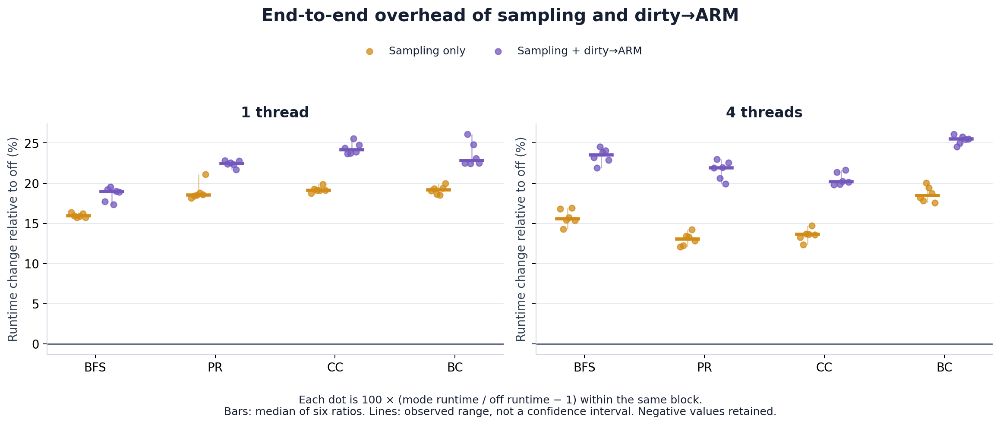
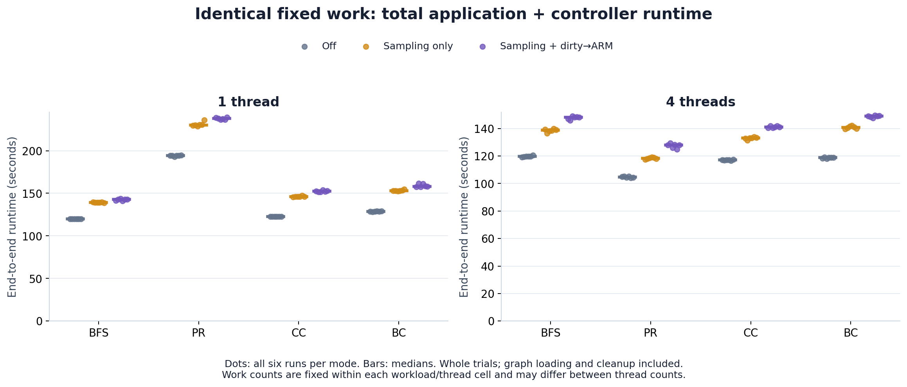
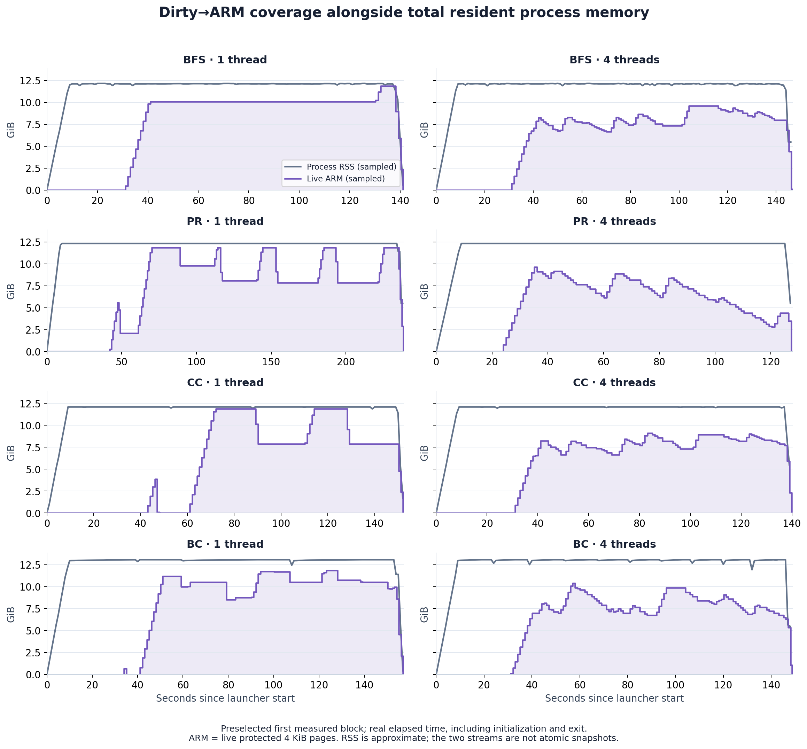

# Matched GAPBS overhead — 2026-10-22

**144/144 measured runs passed:** BFS, PR, CC and BC; 1 and 4 threads; off (A), dirty sampling only (B), and sampling + dirty→ARM (C); six repetitions of every cell/mode. No measured failures, retries or exclusions. Measured campaign: 02:23:44–08:20:37 CDT.

Across the eight cells, median end-to-end overhead was **13.1–19.2% for B/A** and **19.0–25.5% for C/A**. C/B medians were **2.6–8.1%**. Sampling alone is a substantial cost even when few WP events occur. These are cell-level median ranges, not pooled estimates or confidence intervals.

## End-to-end overhead

Values are **median [minimum–maximum] of six within-block percentages**, `100 × (numerator / denominator − 1)`. Every A/B/C order permutation appears once per cell. All successes, including slower cases, are retained. Percentage changes are not additive. C/B compares active policies: C can skip already-ARMed pages and changes scan cadence, admission, recovery and contention; it does not isolate WP-handler cost.

| Workload · threads | Sampling / off | Dirty→ARM / off | Dirty→ARM / sampling |
| --- | ---: | ---: | ---: |
| BFS · 1 | 15.9% [15.7–16.4] | 19.0% [17.4–19.6] | 2.6% [1.2–3.3] |
| BFS · 4 | 15.6% [14.3–16.9] | 23.5% [21.9–24.6] | 6.6% [5.5–7.9] |
| PR · 1 | 18.5% [18.1–21.1] | 22.5% [21.7–22.8] | 3.2% [1.4–4.0] |
| PR · 4 | 13.1% [12.1–14.2] | 21.9% [19.9–23.0] | 8.1% [5.0–9.6] |
| CC · 1 | 19.1% [18.8–19.9] | 24.1% [23.7–25.6] | 4.3% [3.4–5.4] |
| CC · 4 | 13.6% [12.3–14.7] | 20.2% [19.8–21.6] | 5.8% [5.4–8.1] |
| BC · 1 | 19.2% [18.5–20.0] | 22.8% [22.5–26.1] | 3.2% [2.1–5.7] |
| BC · 4 | 18.5% [17.6–20.0] | 25.5% [24.6–26.1] | 5.7% [4.2–6.8] |



## Fixed work and runtime

Table: median primary runtime. Primary timing starts immediately before the common launcher invocation and ends at blocking `wait()` completion. It includes graph loading/initialization, complete algorithm trials, target exit and controller STOP/drain. Graph cache warming is outside timing. Child lifetime and GAPBS trial-time sum are secondary measures in the data export.

| Workload · threads | Trials | Off A (s) | Sampling B (s) | Dirty→ARM C (s) |
| --- | ---: | ---: | ---: | ---: |
| BFS · 1 | 38 | 120.09 | 139.21 | 142.89 |
| BFS · 4 | 127 | 119.64 | 138.75 | 148.10 |
| PR · 1 | 1 | 194.26 | 230.27 | 237.73 |
| PR · 4 | 2 | 104.70 | 118.25 | 127.98 |
| CC · 1 | 24 | 122.68 | 146.19 | 152.33 |
| CC · 4 | 86 | 117.16 | 133.16 | 140.99 |
| BC · 1 | 3 | 128.58 | 153.11 | 158.16 |
| BC · 4 | 10 | 118.88 | 140.75 | 149.11 |

Off-mode pilots froze whole-trial counts before measurement. PR uses 21 iterations per trial (`-i 21 -t 0 -l`); BC uses one source per trial (`-i 1 -l`). BFS/BC deterministic source sequences and all trial/iteration counts match across modes/repeats. PR-1 exceeds two minutes because one complete trial already takes about 194 seconds. Monitored modes were allowed to finish identical work. Counts differ across thread counts, so these times do not measure thread speedup.



## Coverage, writes and memory

Mean live ARM integrates protected byte-time over each whole job, including startup/cleanup. The table summarizes six per-run means; WP counts are write-terminated CMD-P generations, not unique pages or every Linux page fault.

| Workload · threads | Mean live ARM (GiB), median [range] | WP events, range | Revoke service, median ms | Completed C sweeps, range |
| --- | ---: | ---: | ---: | ---: |
| BFS · 1 | 8.66 [7.51–9.15] | 0–4 | 0.005 | 13–13 |
| BFS · 4 | 5.94 [5.85–6.20] | 1–2 | 0.001 | 14–14 |
| PR · 1 | 7.28 [6.94–7.60] | 4,773–47,948 | 10.248 | 23–24 |
| PR · 4 | 5.41 [5.11–5.69] | 1–2 | 0.002 | 12–12 |
| CC · 1 | 5.56 [5.44–6.25] | 6–6 | 0.008 | 14–15 |
| CC · 4 | 5.98 [5.85–6.17] | 0–2 | 0.000 | 13–13 |
| BC · 1 | 7.44 [7.23–7.67] | 68,152–131,384 | 150.357 | 15–16 |
| BC · 4 | 5.91 [5.00–6.80] | 1–1 | 0.001 | 9–12 |

The revoke-service timer covers `cmdp_prepare_write()` around `cmdp_revoke()`. It excludes fault entry/lookup, later counter-lock work and the remaining Linux fault path. Its small values cannot be read as total fault overhead. Diagnostic sampling/flush/lock timers overlap or measure waiting; do not sum them to infer slowdown.



The coverage illustration uses the **predeclared first measured block**, not a run selected for favorable coverage or timing. RSS and ARM are separate sampled streams with real timestamps. Exit-time ARM falls are cleanup. Other unprotected RSS can include recently written, not-yet-qualified, unsupported or unscanned pages.

Peak target RSS stayed about **12.32 GiB** for BFS/PR/CC and **13.08 GiB** for BC in all modes. The maximum within-cell span across all modes/repeats was under 1 MiB. This does not mean zero kernel memory cost: B/C reported **520.7–630.5 MiB of history objects** at the final observation. That accounting excludes XArray/cohort allocator overhead and other CMD-P kernel allocations. Target RSS also excludes the controller.


## Controls and validation

- Same kernel `7.2.6-cmdp-rearm-production`, boot, GAPBS binaries and Twitter graph throughout. Quiet time and requested period are 10 seconds; observation is every second. Maximum pages/history entries: 8,388,608 each. Dummy publish/revoke backend; existing supported private-anonymous 4 KiB CPU-writer scope.
- A uses `--monitor-off`: no device open, attachment or scanner. B uses `--dirty-observe`: dirty sampling/reset/flush/history with no ARM. C uses `--dirty-qualify`: sampling plus quiet-page ARM and recovery. Every mode retains the same external runtime/RSS observation.
- CPU 0 for one thread, CPUs 0–3 for four; all node 0. Fixed OpenMP placement; dynamic teams off. Target THP disabled before exec, host NUMA balancing enabled, governor `ondemand`. Warm file cache before every native run. All modes use the same CMD-P-enabled kernel; this is not a comparison against an unmodified kernel.
- Preflight passed 26 controller checks, 321 kernel fixture checks, three direct mode checks, 24 generated workload/thread/mode correctness cases, eight separate full-Twitter off-mode correctness cases and eight sizing pilots. Prior full-Twitter C correctness receipts use the same kernel/binaries. The complete BFS-1 A/B/C smoke block is excluded from performance statistics. Timed runs do not invoke the verifier; separate PR verification uses positive tolerance.
- All 144 timed cases passed exact-work, mode, thread/affinity/THP, exit, conservation and host-health checks. Final ownership is zero (`entries = managed = isolated = 0`); cumulative ARM/publish/revoke totals agree. No new kernel warnings/errors. Boot, kernel/image, graph, binaries, settings and source freeze were checked again after completion.
- No kernel, GRUB, reboot or host-setting changes in this campaign. Userspace launcher/harness changes were committed and pushed before measurements.

## Data and reproduction

- [All 144 run rows](analysis/runs.csv), [48 paired rows](analysis/paired-overheads.csv), [full statistics and first-block series](analysis/analysis.json), [input hashes](analysis/input-manifest.json).
- [Standalone analysis source](analysis/analyze-matched-gapbs.py). The same source is installed as `tools/testing/selftests/cmdp/scripts/analyze-matched-gapbs.py` in the repository.
- Every figure is also available as SVG and PDF beside its PNG. Plot dependencies: Python, NumPy and Matplotlib; `--no-plots` needs only Python's standard library.

```sh
python3 analysis/analyze-matched-gapbs.py /path/to/raw-bundle --out /tmp/matched-analysis
```

Raw bundle: BMP `/home/yans3/cmdp-v2/periodic/matched-gapbs-20261022-v1`, also archived in the Obsidian study under `results/20261022-matched-gapbs-overhead/run/`. It contains commands, stdout, monitor/RSS JSONL, per-run validation/health records, source/build snapshots, pilots/correctness/smoke records, campaign receipts and a final audit. Raw host logs are not included in this repository report. `raw-manifest.json` hashes 1,936 files (134,505,606 bytes), excluding itself; every archived size/hash was checked. Its SHA-256 is `7e463fcd47873e95fd117dcc14c97275b09bebe93973130bb13684a7eab6fd4e`.

Measured source freeze: [a62020032a303f228617cb6ad654af2f55c4d7ef](https://github.com/ynnsau/linux-7.2.6-wp/commit/a62020032a303f228617cb6ad654af2f55c4d7ef). Launcher change: [a7a536eef66aad81478b87fb86b18fe4260558cb](https://github.com/ynnsau/linux-7.2.6-wp/commit/a7a536eef66aad81478b87fb86b18fe4260558cb). Kernel behavior commit: `0b4d4a2a6174dc5de227252e5d900121b5fd9cb8`; running build ID: `af98a59cd997005cf396c829f814f03a1986c6b4`. GAPBS commit: `941462c7c42e786e4e006a9211b0576ef78d23f7`; graph SHA-256: `4b7e5193a8e3384b8319359dc8c92534b8aee8e48d6c3bd0820451bb307d6eea`.
